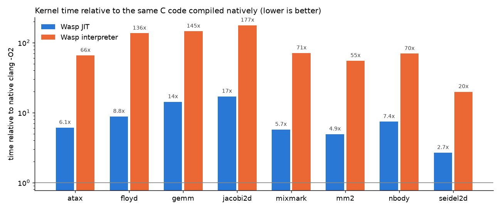

# Wasp

A WebAssembly runtime written from scratch, made of four parts:

- **Runtime (Rust):** a binary decoder, validator and interpreter, and an x86-64 JIT. There are no
  Rust dependencies.
- **WASI (C):** an implementation of WASI preview 1, so real programs compiled from C, Rust and Go
  run on it.
- **Server (Go):** runs Wasm "functions" in isolation, each one in its own process with memory and
  time limits.
- **Playground (TypeScript):** you write C or WebAssembly text, the server compiles it and runs it.



## Results

### Official spec tests

The suite is the WebAssembly 2.0 core suite, tag `wg-2.0` of
[WebAssembly/spec](https://github.com/WebAssembly/spec/tree/wg-2.0/test/core). Its 90 core files
cover:

- numeric semantics;
- control flow;
- memory, tables and references;
- bulk memory;
- multi-value;
- linking;
- the binary and text formats;
- malformed and invalid modules.

Every module definition and every assertion counts as one check.

| | Checks | Passed |
|---|---:|---:|
| Core tests (90 files), interpreter | 27,997 | **27,997 (100%)** |
| Core tests (90 files), JIT | 27,997 | **27,997 (100%)** |
| SIMD tests (58 files, `simd/`) | 25,987 | 686 (2.6%): SIMD is not implemented |
| Whole 2.0 suite | 53,984 | 28,683 (53.1%) |

How the checks are counted:

- `assert_invalid` passes only when the module decodes and validation rejects it.
- `assert_malformed` passes when the module is rejected before instantiation.
- Error messages are not compared.
- The text format is parsed by Wasp's own parser, which is needed to run the `.wast` scripts at all.

The SIMD checks that pass are the few malformed/invalid-module assertions that need no SIMD
support.

### Speed

There are 8 C programs, each compiled twice with the same flags (clang, `-O2 -ffp-contract=off`):
once to wasm32, and once natively for x86-64.

- **The programs:**
  - six PolyBench-style kernels: gemm, 2mm, atax, jacobi-2d, seidel-2d, floyd-warshall;
  - a CoreMark-style integer workload: linked lists, an integer matrix, a state machine and CRC;
  - an n-body simulation.

  All of them were written for this project; none comes from PolyBench or EEMBC CoreMark.
- **What is timed:** each program times its own kernel, without start-up.
- **Correctness:** each prints a checksum, and every run must match the native checksum.
- **Runs:** the best of 3 runs is kept, on an 8-core laptop CPU with AVX2 running Windows 11.

| Program | Native | Wasp JIT | Wasp interpreter | JIT vs native | Interpreter vs native | JIT speed-up over the interpreter |
|---|---:|---:|---:|---:|---:|---:|
| atax | 48.9 ms | 299 ms | 3,205 ms | 6.1× | 66× | 10.7× |
| floyd-warshall | 35.1 ms | 309 ms | 4,780 ms | 8.8× | 136× | 15.5× |
| gemm | 10.4 ms | 148 ms | 1,510 ms | 14.2× | 145× | 10.2× |
| jacobi-2d | 32.0 ms | 547 ms | 5,659 ms | 17.1× | 177× | 10.4× |
| mixmark (CoreMark-style) | 77.5 ms | 444 ms | 5,505 ms | 5.7× | 71× | 12.4× |
| 2mm | 19.7 ms | 97 ms | 1,086 ms | 4.9× | 55× | 11.2× |
| n-body | 220 ms | 1,634 ms | 15,336 ms | 7.4× | 70× | 9.4× |
| seidel-2d | 58.6 ms | 157 ms | 1,165 ms | 2.7× | 20× | 7.4× |

**What the numbers mean:**

- **JIT vs native:** the JIT is a baseline compiler, 2.7–17× slower than native code. It has no
  register allocator: every value lives in a stack slot. Native clang also vectorises the dense
  kernels (gemm, jacobi-2d).
- **Optimisations already in the JIT:** a pass that defers `local.get` and constants into the
  instructions that use them, and one that folds `local.set` into the instruction before it.
  Together they made gemm 1.45× faster and mixmark 1.4× faster.
- **JIT vs interpreter:** the JIT is 7–15× faster than the interpreter.

**Comparison with wasmtime and wasm3:** none was made. Running other runtimes' binaries (and the
original CoreMark and PolyBench sources) was ruled out for this project. Native code is the
baseline instead.

### Start-up time

**In process:** median of 15 `wasp run --stats` runs.

| Module | Size | Decode | Validate | JIT compile | Instantiate, JIT compile included | Machine code |
|---|---:|---:|---:|---:|---:|---:|
| hello (C) | 2.7 KB | 0.19 ms | 0.11 ms | 0.11 ms | 0.20 ms | 12 KB |
| mixmark (C) | 5.1 KB | 0.17 ms | 0.13 ms | 0.19 ms | 0.28 ms | 23 KB |
| hello (Go 1.27, `GOOS=wasip1`) | 2.6 MB | 7.2 ms | 37.7 ms | 50.1 ms | 59.0 ms | 11.2 MB |

**Through the server:** 50 calls of the hello function. Each call starts a fresh `wasp` process.

| Engine | Process start to exit, median / p95 | HTTP round trip, median / p95 |
|---|---:|---:|
| JIT | 12.1 / 13.9 ms | 14.4 / 29.4 ms |
| Interpreter | 11.8 / 12.9 ms | 14.0 / 32.7 ms |

Creating the process (on Windows) dominates. Loading and compiling the function itself takes about
half a millisecond.

### Isolation

Eleven hostile modules ([security/](security)) were run through `wasp run` with each engine. All 22
runs were stopped in a controlled way, and the host process never crashed.

| Module | What it does | Outcome (JIT and interpreter) |
|---|---|---|
| oob_load | load from address 0xFFFFFFF0 with 64 KiB of memory | trap: out of bounds memory access |
| oob_store | store one byte past the end of memory | trap: out of bounds memory access |
| memory_bomb | `memory.grow` in a loop | growth refused at the 64 MiB cap; the process peaks at 53–56 MB |
| memory_initial | asks for 4 GiB at instantiation | instantiation refused: memory limit exceeded |
| infinite_loop | `loop br 0` forever | trap: interrupted, after 0.52 s with a 500 ms deadline |
| deep_recursion | unbounded recursion | trap: call stack exhausted |
| big_frames | recursion with 20,000 locals per frame | trap: call stack exhausted (frame space) |
| table_oob | `call_indirect` past the end of the table | trap: undefined element |
| signature_mismatch | `call_indirect` with the wrong signature | trap: indirect call type mismatch |
| wasi_escape | `path_open` of `../outside.txt`, `/etc/passwd`, `sub/../../outside.txt` | all refused (ENOTCAPABLE); a secret file next to the sandbox never appears |
| wasi_bad_pointer | WASI calls with iovecs and buffers outside memory | EFAULT for both, no crash |

The Go server adds two layers on top of this:

- every call runs in a separate OS process with an empty scratch directory as its only visible file
  system;
- the process is killed if it outlives its deadline by one second.

## How it works

### Runtime (Rust, `runtime/`, about 6,000 lines, no dependencies)

**Decoder** ([decode.rs](runtime/src/decode.rs)): all sections, LEB128 with the spec's overflow
rules, and the malformed-module errors.

**Validator and lowering** ([validate.rs](runtime/src/validate.rs)): the spec's type-checking
algorithm, with operand-stack polymorphism after branches. In the same pass it lowers each function
to an internal code:

- Every value gets a fixed slot in the function's frame: parameters and locals first, then each
  operand-stack position at its statically known height. Instructions name their slots, so neither
  engine keeps a stack pointer at run time.
- Branches carry the slots to copy their results from and to.
- Unreachable code is validated but not lowered.

**Interpreter** ([runtime.rs](runtime/src/runtime.rs)):

- one `match` loop over the lowered code;
- an explicit call stack (deep recursion can't overflow the host's stack);
- checked memory accesses;
- an interrupt flag polled at loop headers;
- the spec's semantics for NaN, signed zeros, trapping conversions and rounding.

It also handles instantiation and cross-module linking.

**JIT** ([jit.rs](runtime/src/jit.rs)): an assembler and code generator for x86-64, written from
scratch.

- **Calling convention:** one SysV-ABI function per Wasm function, with these registers:
  - `rbx`: the frame;
  - `r15`: the context;
  - `r14` / `r13`: the base and length of linear memory.
- **Memory accesses:** explicitly bounds-checked.
- **Floating point:** SSE, with `roundss`/`roundsd` for ceil, floor, trunc and nearest.
- **`br_table`:** a jump table.
- **Calls:** direct calls go through a per-instance table of entry points; calls into host
  functions and `call_indirect` go through helpers.
- **Rare instructions:** the trapping and saturating conversions and the bulk-memory and table
  instructions call the interpreter's own code, so their semantics are identical by construction.
- **Executable memory:** mapped writable, filled, then made read+execute (W^X).

**Limits**, enforced the same way by both engines:

- a cap on linear memory;
- a deadline (a watchdog thread sets the interrupt flag);
- a call-depth limit;
- a frame-space limit.

**Text format** ([wat.rs](runtime/src/wat.rs)): a lexer and a compiler to the binary format,
covering:

- folded and plain instructions;
- every abbreviation the spec tests use;
- hex floats with correct round-to-nearest-even;
- NaN payloads.

`wasp wat2wasm` also validates the result.

### WASI (C, `wasi/`)

`wasi_snapshot_preview1` provides:

- arguments and environment;
- clocks and random bytes;
- `fd_read`, `fd_write`, `fd_seek`, `fd_close`;
- fdstat and filestat;
- preopened directories;
- `path_open`, `path_filestat_get`, `path_create_directory`, `path_unlink_file`;
- `poll_oneoff` (sleeping);
- `sched_yield`, `proc_exit`.

**Guest pointers:** every pointer from the guest is bounds-checked against its memory (EFAULT).

**Paths:** a path is resolved component by component below a preopened directory. Absolute paths,
and `..` that would leave the directory, fail with ENOTCAPABLE.

**Build:** `build.rs` compiles the C into a static library. The runtime calls it through a single
entry point.

**Programs that run on it:**

- C built without a C library ([examples/wasi_min.h](examples/wasi_min.h));
- Rust built for `wasm32-unknown-unknown` ([examples/rust-hello](examples/rust-hello));
- Go 1.27 built with `GOOS=wasip1`: prints, reads the clock, writes and reads back a file.

### Server (Go, `server/`)

The API:

- `POST /api/compile` turns C (clang to wasm32) or WebAssembly text into a module;
- `POST /api/functions` uploads a `.wasm`;
- `POST /api/functions/{id}/run` runs a module with arguments, an engine, a deadline (up to 10 s)
  and a memory cap (up to 256 MB).

Each run:

- is a separate `wasp` process, started with an empty environment;
- has its own scratch directory as its only visible file system;
- is named only by the module's id in `argv[0]` (no host path);
- has its output capped at 1 MB;
- returns the runtime's timing breakdown.

Concurrency is limited to the number of CPUs.

### Playground (TypeScript, `web/`)

An editor with examples, including two hostile ones. You choose:

- the language;
- the engine;
- the arguments;
- the deadline and memory cap.

It shows the program's output, how it ended (exit code or trap, explained), and every timing:
compiling the source, decoding, validating, JIT compiling, instantiating, running, the whole
process, and the round trip.

## Limitations

- **No SIMD.** The `v128` instructions are not implemented, so 25,301 of the suite's checks fail.
- **Baseline JIT:** no register allocation, which makes it 2.7–17× slower than native code.
- **Symbolic links** inside a preopened directory are followed. WASI resolves paths textually and
  does not check where a link points.
- **The server's isolation** is a separate process plus the runtime's own limits. There is no OS
  sandbox (seccomp, job objects, containers) around the `wasp` process.
- **Measurement platform:** every number above is from one Windows laptop. CI runs the tests on
  Linux and Windows but no benchmarks.

## Building and running

The runtime needs Rust and clang (for `wasi.c`; on Windows also `llvm-ar`).

```bash
cd runtime && cargo build --release && cargo test --release
python tools/fetch_testsuite.py                                   # the spec tests -> data/testsuite
runtime/target/release/wasp wast --jit data/testsuite/*.wast      # 27997 passed, 0 failed
runtime/target/release/wasp run --dir . program.wasm args...      # a WASI program
```

```bash
python bench/run.py          # speed (results/bench.json, docs/bench.png)
python bench/startup.py      # start-up (results/startup.json)
python security/run.py       # isolation (results/security.json)
```

```bash
cd web && npm ci && npm run build
cd ../server && go run .     # http://127.0.0.1:8090: the playground and the API
```

**CI** covers both platforms:

- on Ubuntu and Windows: builds the runtime and runs its tests, all 90 core spec files with both
  engines (it must be 100%), and the isolation suite;
- on Ubuntu: the Go server's tests and the playground's tests and build.

## License

MIT. The spec tests are downloaded, not included; they are under the Apache 2.0 licence of the
WebAssembly project.
